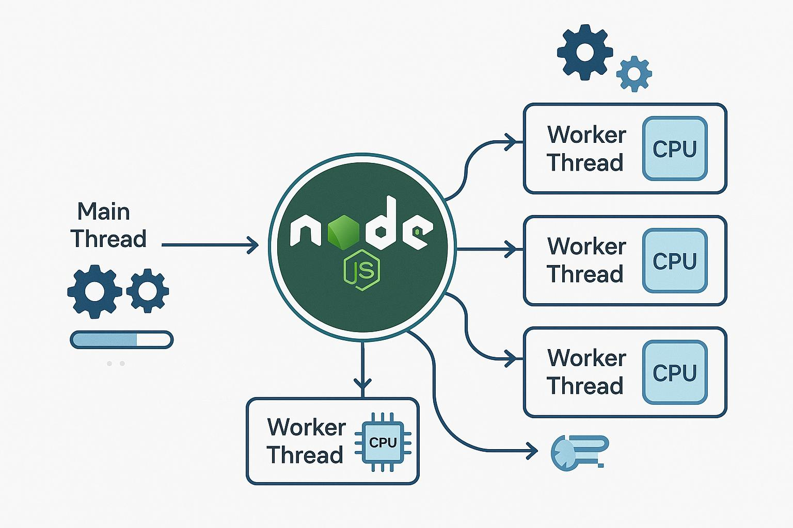
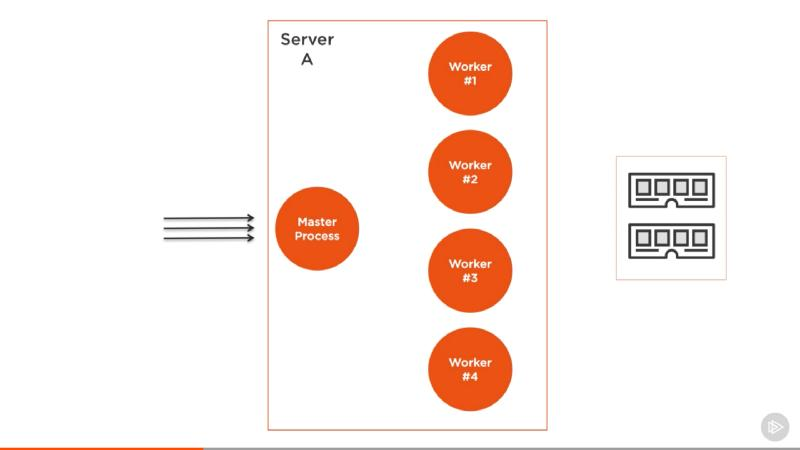

# Node.js: Process vs Thread vs Worker Threads vs Cluster

## 1. Process vs Thread

### 1.1 What is a Process?

A process is an independent instance of a running application.

When we execute a Node.js application:

```bash
node app.js
```

The operating system creates a process.

**Characteristics:**
- Has its own memory space.
- Has its own V8 engine instance.
- Has its own event loop.
- Has its own process ID (PID).
- Processes are isolated from each other.
- Communication happens through IPC (Inter-Process Communication).

**Example:**

```js
// app.js

console.log("Process ID:", process.pid);
console.log("Parent Process ID:", process.ppid);
```

Run:

```bash
node app.js
```

Each independently started Node.js application generally gets a different process ID.

### 1.2 What is a Thread?

A thread is a unit of execution inside a process.

A process can contain multiple threads.

**Characteristics:**
- Threads execute within a process.
- Threads share the process's memory space.
- Each thread has its own stack.
- Threads are generally lighter than processes.
- Threads can communicate through shared memory or message passing.

**Example:**

Imagine a Node.js application running with Worker Threads:

```text
Node.js Process
      |
      |---- Main Thread
      |
      |---- Worker Thread 1
      |
      |---- Worker Thread 2
```

All these threads belong to the same process.

### 1.3 Process vs Thread Comparison

| Feature | Process | Thread |
|---|---|---|
| Definition | Independent running application | Execution unit inside a process |
| Memory | Separate memory space | Shares process memory |
| Stack | Own memory | Own stack |
| Communication | IPC | Message passing / Shared memory |
| Creation cost | Generally higher | Generally lower |
| Isolation | Stronger | Less isolation |
| Failure impact | Usually isolated | Can affect the whole process |
| Node.js example | Cluster | Worker Threads |

### 1.4 Real-World Example

Imagine an e-commerce application.

A process can run the complete application, while multiple threads can perform different tasks inside that process.

For example:

- Main thread: Handles JavaScript and API requests.
- Worker thread 1: Generates reports.
- Worker thread 2: Processes large data calculations.

If we start another independent Node.js application, it creates another process.

**Important:** Node.js normally executes application JavaScript on its main thread. It also uses libuv background threads for certain operations.

---

# 2. Worker Threads vs Cluster in Node.js

Both Worker Threads and Cluster help Node.js utilize multiple CPU cores, but they work differently.

## 2.1 What are Worker Threads?

Worker Threads allow us to execute JavaScript code on multiple threads within the same Node.js process.

They are mainly useful for CPU-intensive tasks.

**Use cases:**
- Heavy mathematical calculations.
- Image processing.
- PDF generation.
- Large data processing.
- Complex report generation.

### Example: Worker Threads

Project structure:

```text
worker-example/
    |
    |---- main.js
    |
    |---- worker.js
```

**Step 1: main.js**

```js
const { Worker } = require("worker_threads");

console.log("Main thread started");

const worker = new Worker("./worker.js");

worker.on("message", (result) => {
    console.log("Result from worker:", result);
});

worker.on("error", (error) => {
    console.log("Worker error:", error);
});

worker.on("exit", (code) => {
    console.log("Worker exited:", code);
});

console.log("Main thread is free");
```

**Step 2: worker.js**

```js
const { parentPort } = require("worker_threads");

let result = 0;

for (let i = 0; i < 100000000; i++) {
    result += i;
}

parentPort.postMessage(result);
```

**How it works:**

1. Main thread starts the application.
2. Main thread creates a worker.
3. Worker executes the heavy calculation separately.
4. Main thread can continue executing other JavaScript tasks.
5. Worker sends the result using `postMessage()`.
6. Main thread receives the result using the `message` event.

**Important:** Worker Threads run in the same process but have separate JavaScript execution environments and normally separate V8 isolates. They can share memory using `SharedArrayBuffer`.

---

## 2.2 What is Cluster?

Cluster allows us to create multiple Node.js processes.

Each process has:
- Its own memory.
- Its own V8 instance.
- Its own event loop.
- Its own process ID.

Cluster is useful for scaling an HTTP server across multiple CPU cores.

**Use cases:**
- Handling multiple HTTP requests.
- Utilizing multiple CPU cores.
- Improving server throughput.
- Running multiple application instances.

### Example: Cluster

Project structure:

```text
cluster-example/
    |
    |---- app.js
```

**app.js**

```js
const cluster = require("cluster");
const http = require("http");
const os = require("os");

const numCPUs = os.availableParallelism();

if (cluster.isPrimary) {
    console.log("Primary process:", process.pid);

    // Create multiple worker processes
    for (let i = 0; i < numCPUs; i++) {
        cluster.fork();
    }

    cluster.on("exit", (worker, code) => {
        console.log("Worker exited:", worker.process.pid);

        // Restart worker if it crashes
        if (code !== 0) {
            cluster.fork();
        }
    });

} else {
    http.createServer((req, res) => {
        res.end(`Handled by process: ${process.pid}`);
    }).listen(3000);

    console.log("Worker process started:", process.pid);
}
```

Run:

```bash
node app.js
```

Open:

```text
http://localhost:3000
```

Refresh multiple times. You may see responses from different process IDs.

**How it works:**

1. Primary process starts.
2. It creates multiple worker processes using `cluster.fork()`.
3. Each worker runs an independent Node.js application instance.
4. Workers listen on the same server port.
5. Incoming connections are distributed among workers.
6. If a worker exits, the primary process can create a replacement.

Note: Cluster connection distribution depends on the operating system and Node.js scheduling strategy. A worker replacement strategy should also include restart limits and graceful shutdown handling in production.

---

# 3. Worker Threads vs Cluster Comparison

| Feature | Worker Threads | Cluster |
|---|---|---|
| Creates | Multiple threads | Multiple processes |
| Memory | Separate JS environments; can share memory | Separate process memory |
| V8 instance | Separate isolate per worker | Separate V8 instance per process |
| Event loop | Each worker has its own | Each process has its own |
| Communication | postMessage / SharedArrayBuffer | IPC |
| Resource usage | Generally lower than separate processes | Generally higher |
| Best for | CPU-intensive tasks | HTTP server scaling |
| Failure isolation | Worker can be terminated independently, but shares process fate | Separate process isolation |
| Module | worker_threads | cluster |

## 4. Real-World Scenario: E-commerce Application

Imagine an e-commerce application with thousands of users.

### Scenario A: Worker Threads

A user requests a large sales report.

Generating the report requires heavy calculations.

If we execute the calculation on the main thread, it blocks the event loop.

**Solution:** Use Worker Threads.

```text
             Node.js Process
                   |
             Main Thread
                   |
             Worker Thread
                   |
             Generate Report
                   |
              Return Result
```

Benefits:
- Heavy calculations run separately.
- Main thread remains responsive.
- Other requests can continue processing.

### Scenario B: Cluster

Suppose thousands of users access the same e-commerce API.

One Node.js process may become a bottleneck, particularly when handling many requests.

**Solution:** Use Cluster.

```text
              Primary Process
                    |
          -----------------------
          |          |          |
       Worker 1   Worker 2   Worker 3
          |          |          |
       API Server API Server API Server
          |          |          |
          -----------------------
                    |
              Incoming Requests
```

Benefits:
- Multiple Node.js processes.
- Better utilization of CPU cores.
- Increased request-handling capacity.
- Process-level isolation.

---

# 5. When Should We Use What?

| Requirement | Use |
|---|---|
| Run an independent application | Process |
| Execute JavaScript on another thread | Worker Threads |
| Perform heavy calculations | Worker Threads |
| Generate large reports | Worker Threads |
| Scale HTTP server across CPU cores | Cluster |
| Run multiple Node.js server instances | Cluster |
| Execute shell commands | child_process |
| Perform asynchronous file operations | fs/promises |

---

# 6. Important Interview Questions

### Q1. Is Node.js single-threaded?

Node.js JavaScript normally executes on a single main thread. However, Node.js uses libuv for asynchronous operations and supports Worker Threads for parallel JavaScript execution.

### Q2. Why do we need Worker Threads?

We use Worker Threads to execute CPU-intensive JavaScript tasks without blocking the main event loop.

### Q3. Why do we need Cluster?

We use Cluster to create multiple Node.js processes and utilize multiple CPU cores for better server scalability.

### Q4. Can Worker Threads share memory?

Yes. Worker Threads can share memory using SharedArrayBuffer and coordinate access using Atomics.

### Q5. Can Cluster workers share memory?

No, not directly. Cluster workers are separate processes with independent memory spaces. They can communicate using IPC or external storage.

### Q6. What happens if a Worker Thread crashes?

The worker can emit an error and exit. The parent process can handle the failure and create another worker if required.

### Q7. What happens if a Cluster worker crashes?

The primary process can detect the worker exit and fork a replacement process.

### Q8. Can we use Cluster and Worker Threads together?

Yes. We can use Cluster to create multiple processes and Worker Threads inside each process to handle CPU-intensive tasks.

---

# 7. Interview-Ready Answers

### Process vs Thread

"A process is an independent instance of a running application with its own memory space and resources. A thread is a smaller unit of execution inside a process. Threads share process memory but have their own execution stacks."

### Worker Threads vs Cluster

"Worker Threads execute JavaScript in separate threads within the same process. I use them for CPU-intensive operations such as calculations, report generation and data processing.

Cluster creates multiple independent Node.js processes. I use it to scale an HTTP server across multiple CPU cores and handle more incoming requests.

For example, if I need to generate a large report without blocking API requests, I use Worker Threads. If I need multiple instances of my Express server to handle incoming traffic, I use Cluster."

---

# 8. Quick Revision

| Term | Remember |
|---|---|
| Process | Independent running application |
| Thread | Execution unit inside a process |
| Main Thread | Executes application JavaScript |
| Event Loop | Coordinates asynchronous JavaScript execution |
| libuv | Node.js asynchronous I/O infrastructure |
| libuv Thread Pool | Background threads for certain operations |
| Worker Threads | Parallel JavaScript execution |
| Cluster | Multiple Node.js processes |
| IPC | Inter-Process Communication |
| SharedArrayBuffer | Memory shared between threads |

## Final Memory Trick

- Process = Separate application.
- Thread = Execution unit inside a process.
- Worker Threads = Multiple JavaScript threads in one process.
- Cluster = Multiple Node.js processes.

**Remember:**

1. CPU-intensive task → Worker Threads.
2. HTTP server scaling → Cluster.
3. Separate application execution → Process.
4. Background file system operations → Asynchronous fs APIs.



One primary process creates multiple independent worker processes.


One process, multiple JavaScript threads.


Interview tip: Don't say Worker Threads are always better for performance. Choose based on the workload: CPU-heavy JavaScript needs parallel execution; HTTP scaling often benefits from multiple processes.


